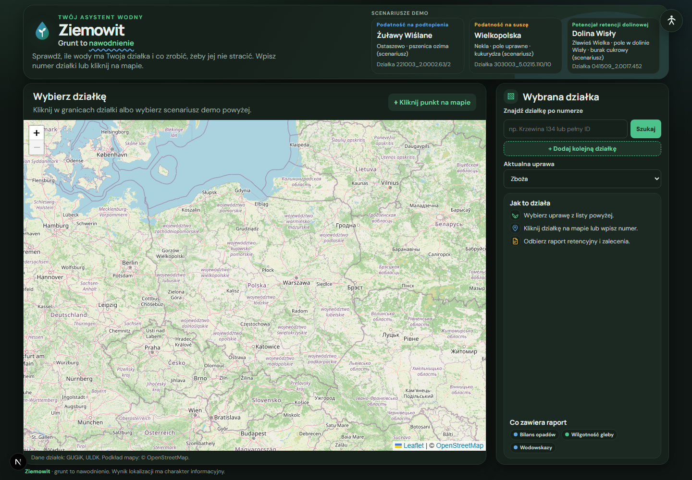
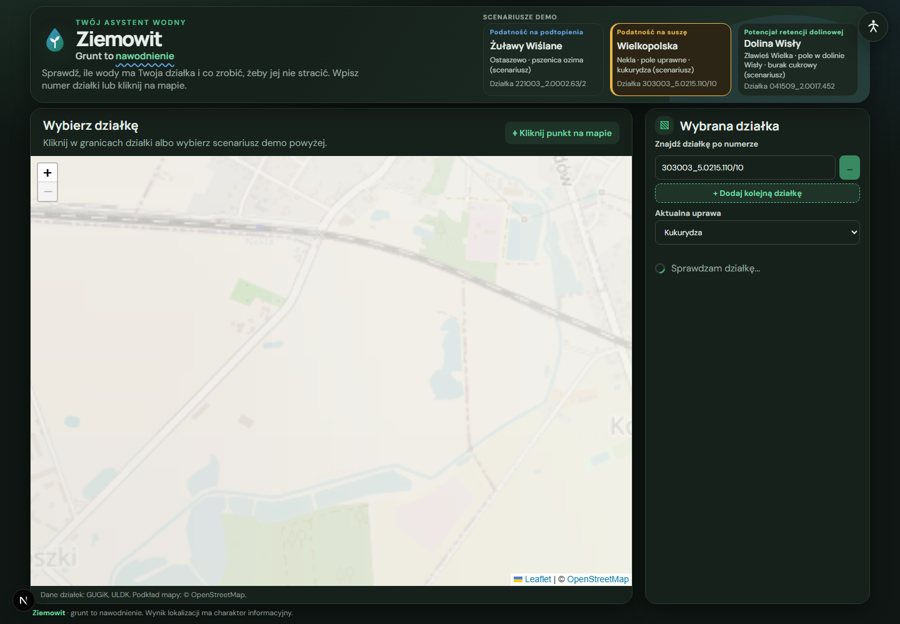
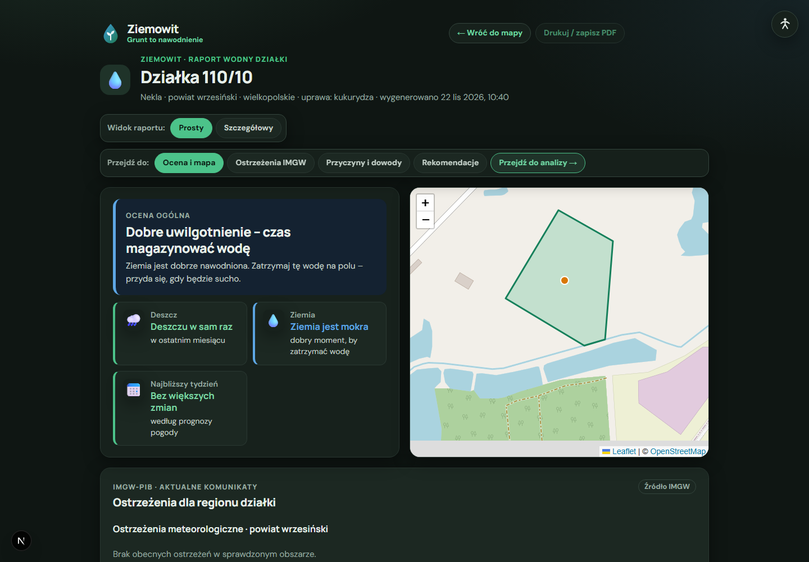
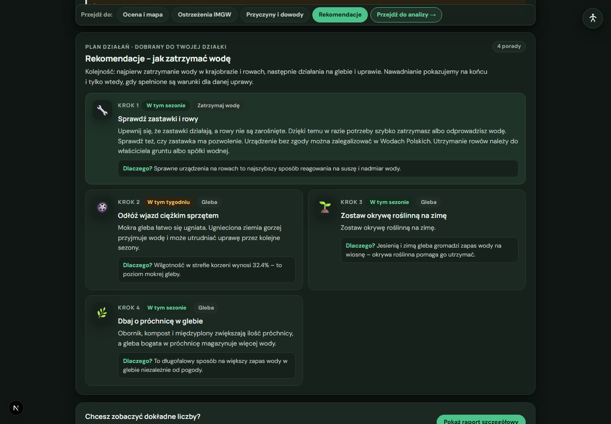

# Ziemowit — grunt to nawodnienie

**HackNation 2026 · zadanie KOWR „Zatrzymaj wodę, chroń plony”**

Ziemowit jest asystentem wodnym dla rolnika. Wskazujesz działkę ewidencyjną w Polsce i uprawę, a aplikacja w przeglądarce zbiera pogodę, glebę, rzeźbę terenu, wodę w okolicy i obraz satelitarny, po czym proponuje kilka konkretnych działań: co zatrzymać, co zrobić na polu i czy w ogóle podlewać.

Rolnik nie potrzebuje GIS, konta ani instalowania czegokolwiek poza przeglądarką.

Działająca wersja: **[ziemowit.mkurowski.dev](https://ziemowit.mkurowski.dev/)**.

| | |
| --- | --- |
| **Rozwiązanie** | Ziemowit — grunt to nawodnienie |
| **Adres** | [https://ziemowit.mkurowski.dev/](https://ziemowit.mkurowski.dev/) |
| **Użytkownik** | rolnik, bez wiedzy GIS i bez specjalistycznego sprzętu |
| **Forma** | aplikacja webowa (Windows, Chrome, Firefox, Edge, Safari, Opera) |
| **Dane osobowe** | nie są zbierane |
| **Płatne usługi** | aplikacja ich nie wymaga |

---

## Jak z tego skorzystać

Otwórz [https://ziemowit.mkurowski.dev/](https://ziemowit.mkurowski.dev/).

1. Wybierz uprawę (na przykład kukurydzę).
2. Wklej identyfikator działki **albo** kliknij pole na mapie. Możesz też nacisnąć jeden z trzech scenariuszy na stronie głównej.
3. Otwórz **raport wodny działki**. Poczekaj, aż karty przestaną się ładować — każda dobiera własne źródło.
4. W raporcie użyj **Drukuj / zapisz PDF** (okno drukowania przeglądarki, opcja „Zapisz jako PDF”).



*Strona główna. Scenariusz opisuje charakter okolicy. Werdykt powstaje dopiero po pobraniu danych dla działki.*



*Działka `303003_5.0215.110/10` w Nekli, uprawa: kukurydza.*



*Raport w widoku prostym: ocena, skrót pogody i granica działki. Obok jest przełącznik na widok szczegółowy.*



*Porady z terminem i zdaniem „dlaczego”, policzone z liczb dla tej działki.*

Działki, od których warto zacząć:

| Identyfikator | Co widać na miejscu |
| --- | --- |
| `303003_5.0215.110/10` | Nekla, Wielkopolska — pole w regionie silnie narażonym na suszę rolniczą |
| `221003_2.0002.63/2` | Ostaszewo, Żuławy — nisko położone, odwadniane pole |
| `041509_2.0017.452` | Zławieś Wielka, dolina Wisły — pole z potencjałem retencji dolinowej |

### Uruchomienie z kodu

Potrzebny jest [Node.js 20](https://nodejs.org/) lub nowszy oraz npm. W katalogu repozytorium:

```bash
npm install
npm run dev
```

Otwórz [http://localhost:3000](http://localhost:3000). Dalsza ścieżka jest taka sama jak na stronie w internecie.

Sprawdzenie, że serwer żyje:

```bash
curl http://localhost:3000/api/health
```

Oczekiwana odpowiedź: `{"status":"ok"}`.

Produkcyjnie, po zbudowaniu:

```bash
npm run build
npm run start
```

Aplikacja nasłuchuje na porcie 3000. Konfiguracja Next.js używa trybu `standalone`, więc ten sam kod można spakować do jednego procesu serwera. Wersja w internecie działa pod adresem [https://ziemowit.mkurowski.dev/](https://ziemowit.mkurowski.dev/).

---

## Jaki problem rozwiązujemy

Polska ma jedne z najniższych zasobów wody w Europie i niską retencję. Susza zabiera plon, a otwarte dane — satelita, pogoda, gleba, rzeki, działki — są rozproszone i napisane językiem specjalistów.

Ziemowit składa je w jeden raport dla **konkretnej działki i konkretnej uprawy**. Kolejność jest stała i wynika z podstaw naukowych zadania:

1. **Ocena sytuacji wodnej** — opad, parowanie, wilgotność gleby, roślinność, podatność gleby, woda w okolicy.
2. **Przyczyny** — każda przyczyna ma źródło i jest opisana jako sygnał, a nie jako pewna diagnoza.
3. **Retencja i agrotechnika** — najpierw zatrzymanie wody tam, gdzie spadła.
4. **Nawadnianie** — tylko gdy uprawa, termin i stan gleby na to wskazują, zawsze z przypomnieniem o pozwoleniu wodnoprawnym.

System nie pokazuje porad z szablonu. Jeśli źródło milczy, raport pisze wprost „brak danych” i obniża pewność oceny. Nie uzupełnia luki liczbą „na oko”.

---

## Co rolnik dostaje

- **Działka po numerze albo z mapy.** Usługa ULDK GUGiK zwraca identyfikator, obręb, gminę, powiat, województwo i geometrię. Punkt poza Polską jest odrzucany.
- **Kilka działek naraz.** Wspólny raport i osobna karta dla każdej.
- **Uprawa:** zboża, rzepak, ziemniaki, buraki, kukurydza, owoce i sad, warzywa albo inna. Od uprawy zależy okno wzrostu, ściółka lub resztki pożniwne oraz to, czy nawadnianie w ogóle wchodzi w grę. Zboża i rzepak nie dostają zalecenia podlewania.
- **Werdykt prostym językiem.** Od stabilnej sytuacji, przez obserwację i niedobór, po wysoką wodę w rzece albo suszę na polu przy wysokim stanie rzeki.
- **Do pięciu porad z terminem:** zrób teraz, w tym tygodniu, w tym sezonie. Przy każdej jest zdanie „dlaczego” oparte na liczbach z raportu.
- **Mapa działki, obraz Sentinel-2 wycięty do granicy pola, NDVI i porównanie z analogicznym okresem rok wcześniej.**
- **Podatność gleby IUNG** (kategoria dominująca na powierzchni działki, nie jeden punkt) zestawiona z opadem.
- **Uziarnienie** (piasek, pył, ił) i przeliczenie wilgotności na wskaźnik dostępnej wody.
- **Spływ z numerycznego modelu terenu:** nachylenie, kierunek odpływu, zagłębienia.
- **Najbliższe wodowskazy IMGW, trend przepływu w zlewni i ostrzeżenia meteorologiczne oraz hydrologiczne.**
- **Źródła, data pobrania, ograniczenia i poziom pewności.**
- **Zapis PDF** przez drukowanie raportu.

Interfejs liczy **dzień bieżący**. Silnik pogody przyjmuje też datę historyczną z ostatnich 10 lat (`POST /api/weather`, pole `date` w formacie `RRRR-MM-DD`) i porównuje ją z tym samym 30-dniowym oknem w poprzednich latach. W widoku dla rolnika tej daty jeszcze się nie wybiera.

---

## Jak liczony jest wynik

Ocena jest deterministyczna. Kod w `apps/web/app/raport/assessment.ts` i `advice.ts` dostaje świeże liczby i zwraca werdykt oraz porady. Progi siedzą w `advice-config.ts`.

Sygnały układają się warstwami, podobnie jak w złożonych wskaźnikach suszy: sama pogoda to obserwacja, gleba podnosi ostrzeżenie, gleba razem z osłabioną roślinnością daje alarm na polu. Osobno pilnowany jest nadmiar wody — stan ostrzegawczy lub alarmowy na wodowskazie w promieniu 15 km.

Do werdyktu wchodzą między innymi:

- suma opadów z 30 dni wobec średniej z analogicznych okien w poprzednich latach (próg około ±20%);
- bilans opad minus ewapotranspiracja referencyjna ET₀ (FAO) wobec normy tego miejsca;
- najdłuższa seria dni z opadem poniżej 1 mm;
- wilgotność strefy korzeniowej 9–27 cm, a gdy jest uziarnienie — wskaźnik między punktem trwałego więdnięcia a polową pojemnością wodną;
- trend przepływu w zlewni (model GloFAS), tylko dla zlewni od 2000 km²;
- NDVI z czystej sceny Sentinel-2 nie starszej niż 10 dni i z co najmniej 70% ważnych pikseli w działce.

Brak hydrologii albo wilgotności gleby obniża pewność i jest napisany w raporcie. Porady retencyjne (zastawki, okrywa, resztki, próchnica, ograniczanie uprawy przesuszonej gleby) mają pierwszeństwo przed nawadnianiem. Każda porada o zastawkach przypomina, że urządzenie wodne wymaga zgody Wód Polskich.

---

## Architektura

Jedna aplikacja Next.js. Przeglądarka pokazuje mapę i raport, a endpointy w tym samym procesie pobierają dane i liczą wskaźniki. Nie ma bazy, konta ani kolejki.

```text
Użytkownik
    |
    v
Next.js (apps/web)
    formularz, mapa Leaflet, raport, druk do PDF
    |
    +-- POST /api/parcels        geometria działki (ULDK)
    +-- POST /api/weather        opad i temperatura, 30 dni + 10 lat
    +-- POST /api/hydro          wilgotność gleby, ET0, GloFAS, wodowskazy
    +-- POST /api/satellite      Sentinel-2, NDVI w granicy działki
    +-- POST /api/drought        podatność gleby IUNG
    +-- POST /api/soil-texture   piasek, pył, ił (SoilGrids)
    +-- POST /api/terrain-flow   nachylenie i spływ z NMT
    +-- POST /api/imgw-warnings  ostrzeżenia meteo i hydro
    |
    v
assessment.ts + advice.ts
    werdykt, przyczyny, maks. 5 porad, pewność, braki
```

Cache jest tylko w pamięci procesu: około 15 minut dla pogody, hydrologii i satelity, 10 minut dla listy wodowskazów, do 12 godzin dla siatki wysokości. Po restarcie znika. **Nie ma zapisanych wcześniej rekomendacji.** Powtórne otwarcie tej samej działki skraca czas, ale liczby i porady i tak powstają z pobranych danych.

---

## Źródła danych

Wszystkie źródła poniżej są publiczne i bezpłatne. Aplikacja pobiera je w chwili analizy. W repozytorium nie ma paczki danych, z której składany jest raport.

| Źródło | Co bierzemy | Kiedy | Zakres |
| --- | --- | --- | --- |
| [ULDK GUGiK](https://uldk.gugik.gov.pl/opis.html) | identyfikator, jednostka ewidencyjna, geometria WKT | na żywo, bez cache | dowolna działka w Polsce (`GetParcelByIdOrNr`, `GetParcelByXY`) |
| [Open-Meteo Archive i Forecast](https://open-meteo.com/) | dobowa suma opadu, temperatura średnia i maksymalna | na żywo; cache 15 min | 30 dni kończących się wybraną datą oraz te same okna z poprzednich lat (do 10 lat). Data spoza tego zakresu jest odrzucana |
| [Open-Meteo Forecast](https://open-meteo.com/) | wilgotność gleby 0–1, 9–27 i 27–81 cm, ET₀, opad, prognoza 7 dni | na żywo; cache 15 min | model w punkcie działki, nie pomiar polowy |
| [Open-Meteo Flood / GloFAS](https://open-meteo.com/en/docs/flood-api) | przepływ rzeczny, 30 dni wstecz i 7 dni prognozy | na żywo; cache 15 min | najbliższa komórka modelu zlewni |
| [IMGW-PIB dane publiczne](https://danepubliczne.imgw.pl/apiinfo) | stany wody, progi ostrzegawcze i alarmowe, przepływ | na żywo; lista stacji cache 10 min | 3 najbliższe wodowskazy z pomiarem |
| IMGW-PIB ostrzeżenia | komunikaty meteo (powiat, TERYT) i hydro (województwo) | na żywo | aktywne ostrzeżenia w chwili zapytania |
| [Earth Search](https://earth-search.aws.element84.com/v1) — Sentinel-2 L2A | pasma B04 i B08, maska SCL, podgląd prawdziwych kolorów | na żywo; cache 15 min | scena z ostatnich 90 dni o zachmurzeniu poniżej 20% oraz scena z analogicznych 90 dni rok wcześniej. NDVI liczone tylko z pikseli wewnątrz działki |
| [IUNG-PIB WMS](https://susza.iung.pulawy.pl/mapa-kategorii/) `Susza:katgl_landuse2024` | kategorie podatności gleby I–IV | na żywo | raster dla obwiedni działki, kategoria dominująca w jej pikselach. To podatność gleby, nie bieżący komunikat suszy |
| [ISRIC SoilGrids](https://docs.isric.org/globaldata/soilgrids/) | udział piasku, pyłu i iłu | na żywo | wierzchnia warstwa w punkcie działki |
| [GUGiK NMT](https://services.gugik.gov.pl/nmt/) | wysokości `GetHByPointList`, układ PL-KRON86-NH | na żywo; cache siatki do 12 h | siatka w działce i w buforze 50 m. Źródłowy model ma rozdzielczość 1 m; próbkujemy rzadziej, do około 6000 punktów |
| [OpenStreetMap](https://www.openstreetmap.org/copyright) | kafelki podkładu mapy | na żywo w przeglądarce | tylko tło, nie wchodzi do obliczeń |

Data pobrania każdej odpowiedzi jest chwilą wywołania (pole `fetchedAt` tam, gdzie źródło je zwraca).

---

## Biblioteki, usługi i sztuczna inteligencja

### Biblioteki aplikacji

| Komponent | Wersja | Rola | Licencja |
| --- | --- | --- | --- |
| Next.js | 16.4.6 | serwer, strony, endpointy | MIT |
| React, React DOM | 19.3.1 | interfejs | MIT |
| TypeScript | 5.8.3 | język | Apache-2.0 |
| Leaflet | 1.9.4 | mapa | BSD-2-Clause |
| react-leaflet | 5.0.0 | mapa w React | Hippocratic License 2.1 |
| proj4 | 2.23.0 | przeliczenie WGS84 ↔ PUWG 1992 (EPSG:2180) | MIT |
| geotiff | 3.0.5 | odczyt rastrów Sentinel-2 | MIT |
| sharp | 0.35.5 | wycinek obrazu satelitarnego i rastra IUNG | Apache-2.0 |

Żadna z tych bibliotek nie jest modelem językowym. Kod własny aplikacji powstał podczas HackNation 2026 i nie ma osobnego pliku licencji open source — prawa do rozwiązania reguluje regulamin konkursu. Licencje komponentów pozostają przy komponentach.

### Usługi zewnętrzne

Wymienione w tabeli źródeł. Prototyp nie używa kluczy API, chmury płatnej ani konta użytkownika.

### Sztuczna inteligencja

**Ziemowit nie wywołuje modelu generatywnego i nie ma własnego modelu uczenia maszynowego.** Werdykt i porady liczy jawny zestaw reguł, który można przeczytać w kodzie i w `docs/rekomendacje-weryfikacja.md`.

Korzystamy z **cudzych produktów modelowych jako ze źródeł danych**, bez ich trenowania i bez zmiany wag:

- wilgotność gleby i ET₀ z Open-Meteo (reanaliza i model pogody);
- przepływ GloFAS (model hydrologiczny Copernicus / ECMWF, udostępniony przez Open-Meteo Flood);
- uziarnienie z mapy SoilGrids (ISRIC).

Tekst raportu jest składany z tych liczb. Nie jest dopisywany przez model językowy.

---

## Licencje i warunki danych

| Zasób | Warunki, których się trzymamy |
| --- | --- |
| Open-Meteo (pogoda, gleba, ET₀, flood/GloFAS) | dane na licencji [CC BY 4.0](https://creativecommons.org/licenses/by/4.0/); wymagana atrybucja. Darmowe API jest przeznaczone do użytku niekomercyjnego ([terms](https://open-meteo.com/en/terms)). Przy większym ruchu dostawca oferuje API komercyjne |
| GloFAS | produkt Copernicus Emergency Management Service; atrybucja Copernicus / ECMWF |
| Sentinel-2 | program Copernicus, bezpłatny i otwarty dostęp. Katalog Earth Search (Element 84 na AWS) nie wymaga konta |
| IMGW-PIB | [dane publiczne](https://danepubliczne.imgw.pl/apiinfo), bezpłatne, z podaniem źródła |
| GUGiK ULDK i NMT | państwowa usługa lokalizacji działek i model terenu; w aplikacji podane jest źródło GUGiK |
| IUNG-PIB | publiczna warstwa podatności gleb Systemu Monitoringu Suszy; podajemy IUNG-PIB. Wynik nie zastępuje oficjalnego komunikatu suszy |
| ISRIC SoilGrids | [CC BY 4.0](https://creativecommons.org/licenses/by/4.0/) |
| OpenStreetMap | kafelki © współtwórcy OpenStreetMap, [ODbL](https://www.openstreetmap.org/copyright) |

Utrzymanie prototypu na jednym komputerze korzysta wyłącznie z tych warstw bezpłatnych. Jedyny koszt, który pojawiłby się przy rozwoju, to hosting aplikacji i — przy dużym ruchu komercyjnym — plan Open-Meteo. Da się go zastąpić archiwum IMGW i publicznym katalogiem Copernicus, kosztem większej pracy integracyjnej.

---

## Ograniczenia, o których mówimy wprost

- Pogoda, wilgotność i uziarnienie są liczone **w punkcie działki**. Obraz satelitarny i kategoria IUNG są liczone **po powierzchni** działki.
- NDVI opisuje zieloną biomasę, a nie wilgotność gleby. Wysoki albo niski wynik bywa skutkiem fazy uprawy, zbioru, choroby albo gołej gleby.
- Silnik umie użyć NDWI, gdy wartość przyjdzie z obserwacji. Obecny odczyt Sentinel-2 liczy NDVI z pasm B04 i B08 i tej drugiej liczby nie dostarcza, więc gałąź „susza fizjologiczna” pozostaje uśpiona.
- Progi SPI są w konfiguracji i zadziałają, gdy wskaźnik będzie w danych. Dzisiejsze porównanie wieloletnie opiera się na odchyleniu sumy opadu od średniej z poprzednich lat, nie na pełnym dopasowaniu rozkładu SPI.
- IUNG mówi, jak gleba **reaguje** na suszę, a nie czy susza jest dzisiaj.
- Uziarnienie jest odczytem z mapy o oczku 250 m. Same zera bez znacznika braku danych pokazujemy jako brak odczytu, nie jako glebę bez piasku.
- Spływ z NMT to potencjalna droga wody po rzeźbie (metoda D8). Nie widzi rowów, przepustów, upraw ani wsiąkania. Dla dużej działki ta karta bywa najwolniejsza i może zejść powyżej 30 sekund; reszta raportu dociąga się niezależnie.
- Wodowskaz dalej niż 15 km nie podnosi werdyktu powodziowego. Ostrzeżenie hydrologiczne IMGW jest wojewódzkie i nie dowodzi, że obejmuje samą działkę.
- Mapy i modele nie zastępują lustracji pola, pozwolenia wodnoprawnego ani komunikatu suszy IUNG.
- Cache znika z restartem serwera. Przy równoległym ruchu wielu użytkowników jeden proces Node wyczerpie limity darmowych API, zanim skończy się CPU.

---

## Jak sprawdzić wynik

1. **Macierz reguł.** W katalogu `apps/web`:

   ```bash
   npm run advice:matrix
   ```

   Skrypt puszcza prawdziwe funkcje `buildSummary` i `collectAdvice` przez 30 sytuacji (susza, nadmiar wody, alarm na rzece, brak danych, różne uprawy i miesiące) i zapisuje `docs/rekomendacje-weryfikacja.md`. Widać tam próg, werdykt i które porady weszły do limitu pięciu.

2. **Ślad w raporcie.** Każda przyczyna ma źródło. Sekcja ograniczeń zbiera komunikaty z pogody, hydrologii i satelity. Status `unavailable` zostaje statusem, a nie zerem.

3. **Porównanie ze źródłem.** Te same liczby można zestawić z:
   - sumą opadu i ET₀ z [Open-Meteo](https://open-meteo.com/) dla współrzędnych z karty działki;
   - stanem wody z [hydro.imgw.pl](https://hydro.imgw.pl/) albo z API danych publicznych;
   - kategorią gleby z [mapą podatności IUNG](https://susza.iung.pulawy.pl/mapa-kategorii/);
   - geometrią z [ULDK](https://uldk.gugik.gov.pl/).

4. **Wejście historyczne pogody** można podać bezpośrednio:

   ```bash
   curl -X POST http://localhost:3000/api/weather ^
     -H "Content-Type: application/json" ^
     -d "{\"latitude\":52.3505,\"longitude\":17.405,\"date\":\"2024-07-15\"}"
   ```

   W PowerShell wygodniej użyć `curl.exe`, żeby nie trafić w alias `Invoke-WebRequest`. Odpowiedź zawiera `historicalSummary` albo jawny status `unavailable`.

---

## Gdyby z tego korzystała cała Polska

Prototyp ma działać dla dowolnej działki, nie dla tysięcy rolników naraz. Żeby do tego dorosnąć:

- **Limity API.** Wspólny cache (na przykład Redis) z kluczem działka + dzień, zamiast pamięci jednego procesu. Osobna, wolniejsza ścieżka dla NMT, żeby reszta raportu wracała od razu. Ponawianie zapytań jest już przy Open-Meteo; przy wzroście ruchu trzeba zejść na plan komercyjny albo na archiwa IMGW i Copernicus.
- **Świeżość.** Pogoda, wodowskazy, ostrzeżenia i satelita i tak są pobierane na żądanie. Wersja krajowa trzymałaby wynik obliczenia najwyżej kilka godzin i liczyła go ponownie, a nie przechowywała gotowych porad.
- **Koszt.** Mały serwer aplikacyjny (jeden kontener z buildem `standalone`) plus ewentualna opłata Open-Meteo przy dużym ruchu. Mapy, IUNG, GUGiK, IMGW i Sentinel-2 zostają publiczne. Obecna wersja pod [ziemowit.mkurowski.dev](https://ziemowit.mkurowski.dev/) korzysta z warstw bezpłatnych.

---

## Bezpieczeństwo prototypu

Nie ma rejestracji, haseł ani pól na dane osobowe. Identyfikator działki i współrzędne są danymi publicznymi. Endpointy sprawdzają zakres współrzędnych Polski, format daty i rozmiar geometrii, a zewnętrzne wywołania mają limit czasu. W repozytorium nie ma kluczy.

Raport ma charakter **informacyjny**. Nie jest decyzją administracyjną, urzędowym stwierdzeniem suszy ani projektem urządzenia wodnego.
