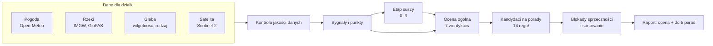

# Ziemowit – jak powstają ocena i porady

**Dokumentacja logiki rekomendacji i rejestr źródeł**
Dla jury i zespołu · NASA Space Apps Challenge 2026, wyzwanie „Adapting Farms with NASA Data” · stan na 21.11.2026

---

## W skrócie

Ziemowit łączy dane pogodowe, hydrologiczne, glebowe i satelitarne dla jednej działki. Na ich podstawie wydaje jedną z siedmiu ocen sytuacji wodnej i do pięciu porad z terminem wykonania.

Każdy próg i każda porada mają wskazane źródło: poradniki Ministerstwa Rolnictwa, Centrum Doradztwa Rolniczego, Wód Polskich i Polskiej Agencji Kosmicznej. Logikę sprawdziliśmy na 30 scenariuszach testowych, a każdy wynik jest generowany z prawdziwego kodu, nie wpisywany ręcznie.

Trzy zasady projektowe:

1. **Susza to proces, nie liczba.** Brak deszczu, przesychanie gleby i słabnięcie roślin to kolejne etapy. Ocena rośnie dopiero, gdy pojawia się następny sygnał – tak jak w Europejskim Obserwatorium Suszy [PAK s. 287–290].
2. **Odchylenie od normy, nie wartość bezwzględna.** Lipcowy bilans −30 mm jest w Polsce normalny, więc porównujemy z tym samym okresem z lat poprzednich [MRiRW; PAK s. 288–289].
3. **Porada musi być wykonalna i legalna.** Nie radzimy nawadniać upraw, których w Polsce się nie nawadnia. Przy nawadnianiu i zastawkach zawsze przypominamy o wymogach Prawa wodnego.

---

## 1. Jak działa logika – przegląd

Kolejne kroki:

1. **Dane** z czterech grup są pobierane dla współrzędnych działki (§2).
2. **Kontrola jakości** odrzuca nieaktualne lub zachmurzone sceny satelitarne i rzeki ze zbyt małych zlewni (§2.3).
3. **Sygnały** przeliczają dane na punkty deficytu i nadwyżki wody (§3).
4. **Etap suszy** (obserwacja, ostrzeżenie, alarm) zależy od tego, które grupy sygnałów są aktywne (§4.1).
5. **Ocena ogólna** łączy etap suszy, nadwyżkę wody i stan rzek (§4.2).
6. **Porady**: każda z 14 reguł sprawdza swój warunek, potem usuwamy porady sprzeczne i zostawiamy pięć najważniejszych (§5–6).

---

## 2. Dane wejściowe

### 2.1. Co mierzymy

| Grupa | Wskaźnik | Źródło danych | Jak liczony |
| --- | --- | --- | --- |
| Pogoda | Opady vs norma | Open-Meteo (archiwum) | suma 30 dni vs średnia tych samych dni z lat poprzednich, % |
| Pogoda | SPI-1, SPI-3 *(planowane)* | Open-Meteo (archiwum ≥ 30 lat) | standaryzowany wskaźnik opadu z 1 i 3 miesięcy |
| Pogoda | Bilans wodny i jego anomalia | Open-Meteo | opad − parowanie potencjalne (ET0) z 30 dni; minus norma tych samych dni |
| Pogoda | Najdłuższa seria bez deszczu | Open-Meteo | dni z opadem < 1 mm w ostatnich 30 dniach |
| Pogoda | Prognoza 7 dni | Open-Meteo | opad − ET0 |
| Gleba | Wilgotność strefy korzeni | Open-Meteo, warstwa 9–27 cm | % objętości |
| Gleba | Rodzaj gleby *(planowane)* | europejska baza gleb (ESDAC) lub SoilGrids | klasa uziarnienia |
| Rzeki | Stan wodowskazów | IMGW-PIB | stan ostrzegawczy / alarmowy na stacjach w pobliżu |
| Rzeki | Trend przepływu | GloFAS (Copernicus) | zmiana przepływu vs średnia 30 dni |
| Rośliny | NDVI | Sentinel-2 L2A | zieleń roślin 0–1, porównanie z normą lub rokiem poprzednim |
| Rośliny | NDWI *(planowane)* | Sentinel-2 L2A, kanały B8A i B12 | woda w roślinach |
| Uprawa | Rodzaj uprawy, ozima/jara | wybór rolnika | kalendarz upraw (§5.1) |

### 2.2. Sezony

| Sezon | Miesiące | Po co |
| --- | --- | --- |
| Wiosna | II–IV | zatrzymywanie wód roztopowych [MRiRW] |
| Wegetacja | IV–IX | nawadnianie, ocena roślin |
| Chłodny | X–II | okrywa roślinna, magazynowanie wody na wiosnę |
| Okno suszy rolniczej | 21 III–30 IX | okres z ustawowej definicji suszy [E-poradnik s. 66] |

### 2.3. Kontrola jakości danych

| Dane | Reguła | Uzasadnienie |
| --- | --- | --- |
| Scena Sentinel-2 | maks. 10 dni i min. 70% czystych pikseli działki wg maski SCL | rewizyta 2–3 dni, ale zachmurzenie może trwać kilkanaście dni [PAK s. 138, 140, 326] |
| Wskaźniki satelitarne | tylko z produktu L2A, kanały w tej samej rozdzielczości | zalecana korekcja radiometryczna, wymagany ten sam rozmiar piksela [PAK s. 92–93] |
| Trend GloFAS | punkty tylko dla zlewni ≥ 2000 km² | GloFAS ma niższą rozdzielczość niż EFAS, a produkty EFAS są dla zlewni > 2000 km² [PAK s. 312] |
| Wodowskazy | tylko stacje do 15 km, najlepiej na tej samej rzece | najbliższa stacja może leżeć na innym cieku |
| Brak danych o rzekach lub glebie | ocena oznaczona jako wstępna, niższa pilność porad | jeden wskaźnik nie wystarcza do pewnej oceny |

---

## 3. Sygnały i punkty

Każdy sygnał należy do jednej z grup: **pogoda (M)**, **gleba (G)**, **rośliny (R)** albo **rzeki**. Grupa decyduje o etapie suszy (§4.1), a punkty – o sile oceny.

| Grupa | Warunek | Deficyt | Nadwyżka | Uzasadnienie |
| --- | --- | --- | --- | --- |
| M | SPI-3 < −1 lub SPI-1 < −2 (zastępczo: opady ≤ −20% normy) | +1 | | progi „Obserwacji” w CDI [PAK s. 290] |
| M | opady wyraźnie powyżej normy | | +1 | |
| M | anomalia bilansu ≤ −40 mm | +2 | | KBW to podstawa oceny suszy [E-poradnik s. 66]; latem parowanie ok. 3,5 mm/dobę [MRiRW] |
| M | anomalia bilansu w (−40; −15] mm | +1 | | j.w. |
| M | anomalia bilansu ≥ +20 mm | | +1 | |
| M | ≥ 10 dni bez deszczu | +1 | | tylko wzmacnia ocenę; o nawadnianiu decyduje woda w glebie, nie liczba dni [E-poradnik s. 255] |
| Rzeki | trend przepływu ≤ −20% (duża zlewnia) | +1 | | susza na rzekach to zwykle niskie stany w rowach [E-poradnik s. 65] |
| Rzeki | trend przepływu ≥ +30% (duża zlewnia) | | +1 | |
| Rzeki | stan ostrzegawczy lub alarmowy | | +2 | definicje IMGW-PIB [E-poradnik s. 16] |
| G | gleba sucha | +2 | | §3.1 |
| G | gleba mokra | | +1 | §3.1 |
| G | spadek wilgotności ≤ −3 p.p. w 30 dni | +1 | | szybkie przesychanie najpierw na glebach lekkich [E-poradnik s. 62] |
| G | wilgotność ≥ 1 odchylenie standardowe poniżej normy | +1 | | „Ostrzeżenie” w CDI: anomalia wilgotności < −1 [PAK s. 290] |
| R | NDVI wyraźnie poniżej normy wieloletniej albo NDVI < 0,5 i NDWI < 0,3 | +1 | | anomalia roślinności w CDI [PAK s. 289–290]; susza fizjologiczna [PAK s. 92] |

### 3.1. Gleba: sucha, umiarkowana, mokra

Wilgotność przeliczamy na wskaźnik od 0 (punkt trwałego więdnięcia) do 1 (polowa pojemność wodna). Tak samo robi Europejskie Obserwatorium Suszy [PAK s. 289].

- **Sucha:** wskaźnik < 0,4.
- **Mokra:** wskaźnik ≥ 1, czyli powyżej polowej pojemności wodnej.
- **Bez danych o rodzaju gleby:** progi zastępcze 15% i 30% objętości, z dopiskiem w raporcie, że są orientacyjne.

Dlaczego nie jeden próg dla wszystkich gleb: 15% wilgotności to dla piasku polowa pojemność wodna, a dla gliny poziom poniżej punktu więdnięcia [MRiRW].

### 3.2. Rośliny: progi NDVI i NDWI

| Wskaźnik | Wartości | Znaczenie | Źródło |
| --- | --- | --- | --- |
| NDVI | −0,1 … 0,1 | gleba odkryta | [PAK s. 293] |
| NDVI | 0,2 … 0,4 | słaba kondycja roślin | [PAK s. 293] |
| NDVI | 0,4 … 0,6 | umiarkowana | [PAK s. 293] |
| NDVI | > 0,6 | dobra i bardzo dobra | [PAK s. 293] |
| NDWI | > 0,4 / 0,3–0,4 / 0,2–0,3 / 0,0–0,2 / < 0 | brak suszy / lekko / umiarkowanie / bardzo / ekstremalnie sucho | [PAK s. 92] |
| NDVI i NDWI | NDVI < 0,5 i NDWI < 0,3 | susza fizjologiczna | [PAK s. 92] |

Ograniczenia, które uwzględniamy:
- **Faza rozwoju.** NDVI słabo reaguje na biomasę w późnych fazach, a przy małym zwarciu przeszkadza mu gleba [PAK s. 91]. Dlatego próg „słabej kondycji” stosujemy tylko w maju–sierpniu.
- **Porównanie rok do roku.** Na działce mogła rok temu rosnąć inna uprawa, a uprawy o podobnej fenologii mają podobne profile NDVI [PAK s. 282]. Dlatego wolimy normę wieloletnią dla tej samej dekady.
- **NDWI czulszy niż NDVI.** NDWI reaguje na więdnięcie, więc lepiej wychwytuje suszę [PAK s. 92].

---

## 4. Ocena ogólna

### 4.1. Etapy suszy

Wzorujemy się na wskaźniku CDI Europejskiego Obserwatorium Suszy (EDO). Deficyt opadów to **Obserwacja**. Gdy dochodzi deficyt wilgotności gleby, mamy **Ostrzeżenie**. Gdy dodatkowo słabną rośliny – **Alarm** [PAK s. 287, 290].

| Etap | Warunek | Nazwa w Ziemowicie |
| --- | --- | --- |
| 0 | brak sygnałów M, G | – |
| 1 | sygnał z pogody lub rzek | Obserwacja |
| 2 | sygnał z gleby albo pogoda + rośliny | Ostrzeżenie |
| 3 | gleba + rośliny | Alarm |

**Świadome odstępstwo od CDI:** w EDO deficyt opadów razem ze spadkiem wzrostu roślin to już Alarm. U nas to Ostrzeżenie, bo NDVI pojedynczej działki jest bardziej zaszumione (chmury, zmiana uprawy) niż wieloletnie dane FAPAR w EDO.

### 4.2. Werdykty

Pierwszy pasujący warunek wygrywa:

| # | Warunek | Werdykt | Tytuł w raporcie |
| --- | --- | --- | --- |
| 1 | stan alarmowy na rzece | `flood` | Nadmiar wody – ryzyko podtopień |
| 2 | stan ostrzegawczy i etap ≥ 2 | `drought-high-water` | Susza na polu, wysoka woda w rzece |
| 3 | stan ostrzegawczy | `flood` | Nadmiar wody – ryzyko podtopień |
| 4 | etap 3 | `deficit-high` | Wysokie ryzyko niedoboru wody |
| 5 | etap 2 i ≥ 3 pkt deficytu | `deficit-high` | Wysokie ryzyko niedoboru wody |
| 6 | etap 2 i deficyt > nadwyżka | `deficit` | Umiarkowane ryzyko niedoboru wody |
| 7 | etap 1 i deficyt > nadwyżka | `deficit-watch` | Mniej wody niż zwykle – obserwuj sytuację |
| 8 | nadwyżka ≥ 2 | `wet` | Dobre uwilgotnienie – czas magazynować wodę (≥ 4 pkt: „Bardzo dużo wody…”) |
| 9 | pozostałe | `stable` | Sytuacja wodna stabilna |

Dlaczego tak:
- **Stan alarmowy zawsze na pierwszym miejscu.** Oznacza zagrożenie dla infrastruktury, zabudowań, życia i zdrowia [E-poradnik s. 16].
- **Duża nadwyżka bez alarmu to nie „powódź”.** Zimowe i wczesnowiosenne zalewy łąk nie przynoszą większych szkód [E-poradnik s. 174], a jesienią i zimą można dopuścić okresowe nadmierne uwilgotnienie [MRiRW]. To czas magazynowania wody, nie alarmu.

---

## 5. Porady

### 5.1. Kalendarz upraw

| Uprawa | Nawadniana w PL? | Okno nawadniania | Miesiące zbioru (przybliżone) | Wariant ściółkowania |
| --- | --- | --- | --- | --- |
| Ziemniaki | tak | 20 V–10 VIII | VIII–X | okrywa między rzędami |
| Warzywa | tak | 15 IV–30 IX | VII–X | okrywa między rzędami |
| Owoce i sad | tak | 1 VI–31 VIII | – | ściółka pod drzewami |
| Kukurydza | tak | 10 VI–31 VIII | IX–XI | resztki pożniwne |
| Buraki | tak | 20 VI–10 IX | IX–XI | resztki pożniwne |
| Zboża | **nie** | – | VII–VIII | resztki pożniwne |
| Rzepak | **nie** | – | VII–VIII | resztki pożniwne |
| Inna | nie (brak danych) | – | – | ogólna okrywa gleby |

Okna pochodzą z tabeli 8 e-poradnika [E-poradnik s. 239]; na północy i północnym wschodzie najwcześniejsze terminy przesuwamy o 5–10 dni. Ze zbóż w Polsce nawadnia się tylko kukurydzę [E-poradnik s. 229], a rzepaku obecnie się nie nawadnia [E-poradnik s. 234].

### 5.2. Katalog porad

| Porada | Kiedy się włącza | Priorytet / termin | Na czym się opiera |
| --- | --- | --- | --- |
| **Przygotuj pole na wysoką wodę** | stan ostrzegawczy lub alarmowy na pobliskim wodowskazie | 1 / teraz | definicje stanów IMGW-PIB [E-poradnik s. 16]; obowiązki na terenach zalewowych [Pobór wód] |
| **Zamknij zastawki na rowach** | ocena niedoboru lub obserwacji | 2–3 / teraz (obserwacja: w tym tygodniu) | zastawki zatrzymują odpływ, ale piętrzenie działa 2 tyg.–1 mies., a w głębokiej suszy rowy są suche [MRiRW] |
| **Zamknij zastawki po roztopach** *(nowa)* | luty–kwiecień, bez niedoboru i alarmu | 3 / w tym tygodniu | całkowite odprowadzenie wód roztopowych to marnotrawstwo [MRiRW]; po bezśnieżnej zimie nawodnienie podsiąkowe zamiast odwadniania [E-poradnik s. 125] |
| **Zatrzymaj nadwyżkę wody** | gleba mokra lub bilans powyżej normy, bez niedoboru i ostrzeżeń; nie w okresie zbioru | 3 / w tym tygodniu | wariant dla ozimin: jesienią nadmierne uwilgotnienie tylko na polach bez ozimin [MRiRW]; otwieranie zastawek ok. 2 tyg. przed zbiorem [E-poradnik s. 125] |
| **Ogranicz uprawę gleby** | gleba sucha | 3 / w tym tygodniu | uprawa bezorkowa unika przesuszenia [E-poradnik s. 102–103]; ograniczenie orki zimowej na lekkich glebach [MRiRW] |
| **Nawadniaj w chłodnych godzinach** | uprawa nawadniana, okno z kalendarza, gleba nie mokra, deficyt wody w glebie | 2 / teraz lub w tym tygodniu | start przy ~połowie wody łatwo dostępnej, przerwa po opadzie > 25–30 mm [E-poradnik s. 251, 255]; bez deszczowania przy wietrze > 4 m/s [E-poradnik s. 258]; podlewanie rano lub wieczorem [Dobre praktyki]; pozwolenie wodnoprawne [Pobór wód] |
| **Nie czekaj na deszcz** | prognoza 7 dni ≤ −15 mm w sezonie (≤ −5 mm poza nim), gleba nie mokra | 3–4 / teraz przy niedoborze | latem tygodniowe parowanie ok. 25 mm [MRiRW]; prognozy opadów są najmniej sprawdzalne [E-poradnik s. 60] |
| **Odłóż wjazd ciężkim sprzętem** | gleba mokra | 3–4 / w tym tygodniu | maszyny zagęszczają glebę [E-poradnik s. 103, 232] |
| **Obejrzyj rośliny na polu** | sezon, aktualna scena, NDVI poniżej normy, NDVI < 0,4 (V–VIII) albo NDVI/NDWI wskazują suszę fizjologiczną | 3–4 / w tym tygodniu | klasy NDVI [PAK s. 293], NDWI [PAK s. 92]; ocena wzrokowa nie zastępuje pomiaru [MRiRW] |
| **Ściółkowanie wg uprawy** | niedobór, obserwacja lub sucha gleba; wariant zależny od miesiąca | 4–5 / w tym sezonie | mulcz ogranicza parowanie nawet o ~60% [E-poradnik s. 100]; resztki pożniwne a próchnica [MRiRW]; ściółki w sadach [MRiRW] |
| **Okrywa roślinna** | sierpień–luty, także przy deficycie | 5 / w tym sezonie | okrywa poprawia retencję i ogranicza parowanie [E-poradnik s. 101, 112] |
| **Obserwuj glebę** *(nowa)* | ocena stabilna, ≥ 10 dni bez deszczu, sezon, gleba nie mokra | 5 / w tym tygodniu | po krótkim deszczu wierzch bywa wilgotny, a niżej sucho [MRiRW] |
| **Sprawdź zastawki i rowy** | zawsze | 5 (III–IV, IX–X) lub 6 / w tym sezonie | konserwacja wiosną i jesienią [E-poradnik s. 155]; obowiązki właściciela i spółki wodnej [Melioracje PW] |
| **Dbaj o próchnicę** | zawsze | 7 / w tym sezonie | próchnica jak gąbka na wodę; Kodeks Dobrej Praktyki Rolniczej [MRiRW] |

---

## 6. Składanie raportu

1. **Blokady sprzeczności.**

   | Gdy | Usuwamy |
   | --- | --- |
   | gleba mokra | nawadnianie, „Nie czekaj na deszcz”, „Obserwuj glebę” |
   | jest porada o nawadnianiu | „Nie czekaj na deszcz” (przechodzi do uzasadnienia), „Obserwuj glebę” |
   | jest porada wiosenna | „Zatrzymaj nadwyżkę” |
   | niedobór lub obserwacja | porady o zatrzymywaniu nadwyżki |
   | stan alarmowy | wszystkie porady o zamykaniu zastawek |

2. **Sortowanie:** najpierw priorytet, potem pilność terminu („Zrób teraz” przed „W tym tygodniu”).
3. **Limit 5 porad.** Porada dopasowana do uprawy nie może wypaść – zastępuje najmniej ważną z pięciu.
4. **Ocena wstępna.** Gdy brakuje danych o rzekach lub glebie, tytuł dostaje dopisek, a „Zrób teraz” zmienia się w „W tym tygodniu” (oprócz porady powodziowej).

---

## 7. Zgodność z prawem

Porady dotyczące wody muszą prowadzić do działań legalnych. Każda porada o nawadnianiu i zastawkach ma krótki dopisek prawny.

| Temat | Co mówi prawo | Dopisek w poradzie | Źródło |
| --- | --- | --- | --- |
| Nawadnianie pól | Pobór wód to usługa wodna; nawadnianie powyżej średnio 5 m³/dobę to szczególne korzystanie z wód. Oba wymagają pozwolenia wodnoprawnego przed rozpoczęciem. | „Nawadniaj tylko z ujęcia objętego pozwoleniem wodnoprawnym.” | [Pobór wód] (art. 34 pkt 12, art. 35 ust. 3 pkt 1 Prawa wodnego) |
| Limit 5 m³/dobę | Bezpłatnego limitu nie można wykorzystać do nawadniania pól. | „1 mm wody na 1 ha to 10 m³.” | [MRiRW] |
| Zastawki i rowy | Budowa urządzeń wodnych wymaga pozwolenia lub zgłoszenia; przebudowa rowów w celu zatrzymania wody to sprawa dla zarządu zlewni Wód Polskich. | „Używaj tylko istniejących, legalnych urządzeń.” | [Melioracje PW; Pobór wód] |
| Urządzenia bez zgody | Można je zalegalizować (opłata 5720,17 zł w 2024 r.); bez tego – decyzja o likwidacji i kara. | „Sprawdź, czy zastawka ma pozwolenie.” | [Legalizacja] |
| Utrzymanie rowów | Należy do właściciela gruntu albo spółki wodnej. | „Zgłoś usterkę spółce wodnej.” | [Melioracje PW] |
| Tereny zalewowe | Gromadzenie obornika, ścieków i chemikaliów na obszarach szczególnego zagrożenia powodzią wymaga pozwolenia. | „Wywieź obornik, nawozy i środki ochrony roślin.” | [Pobór wód] |

Zastrzeżenie: broszura MRiRW z 2020 r. opisuje zniesienie pozwolenia na samo piętrzenie wody w rowie melioracyjnym jako „przewidziane”. Aktualny stan prawny trzeba potwierdzić w obowiązującej ustawie.

---

## 8. Jak sprawdzaliśmy logikę

1. **Generator scenariuszy.** Skrypt `apps/web/scripts/advice-matrix.mts` (`npm run advice:matrix`) przepuszcza scenariusze przez prawdziwe funkcje `buildSummary` i `collectAdvice`. Powstaje raport z regułami, macierzą porad i kartą każdego scenariusza.
2. **Scenariusze testowe.** 21 sytuacji z pierwszej wersji: susza, nadmiar wody, alarmy, wartości na progach, brak danych. Do tego 9 nowych po weryfikacji: roztopy, przeciętny lipiec, susza po żniwach, susza w kukurydzy, ozimina na mokrym polu, alarm przy suszy, piasek vs glina, susza fizjologiczna, mała rzeka i stara scena.
3. **Weryfikacja ze źródłami.** Każdą regułę i każdą kartę porównaliśmy z poradnikami z §10. Wynik dla pierwszej wersji: 4 scenariusze trafne, 12 częściowo trafnych, 4 nietrafne, 1 do oceny eksperta.
4. **Poprawki.** Zmiany z §9 zostały zapisane jako specyfikacja dla zespołu (`ziemowit-advice-spec.md`), z oczekiwanymi wynikami dla wszystkich 30 scenariuszy i listą kryteriów akceptacji.

---

## 9. Co zmieniło się po weryfikacji

| Obszar | Wersja 1 | Wersja 2 | Powód |
| --- | --- | --- | --- |
| Nawadnianie | ≥ 10 dni bez deszczu w sezonie, każda uprawa | okno uprawy + woda w glebie + gleba nie mokra; bez zbóż i rzepaku | [E-poradnik s. 229, 234, 239, 255] |
| Bilans wodny | wartość bezwzględna (≤ −30 mm = +2) | odchylenie od normy | normalny lipiec dawał „wysokie ryzyko” [MRiRW] |
| Ocena suszy | suma punktów | etapy jak w EDO + suma punktów | [PAK s. 287–290] |
| Nowy werdykt | – | „Mniej wody niż zwykle – obserwuj” | etap „Obserwacja” w CDI |
| Powódź | także nadwyżka ≥ 4 bez alarmu | tylko stan ostrzegawczy / alarmowy | [E-poradnik s. 174; MRiRW] |
| Susza przy wysokiej rzece | sama susza w tytule | werdykt łączony | stan alarmowy to zagrożenie życia [E-poradnik s. 16] |
| Gleba | stałe progi 15% / 30% | wskaźnik 0–1 wg rodzaju gleby | [MRiRW; PAK s. 289] |
| NDVI | próg 0,3, porównanie rok do roku | próg 0,4 w V–VIII, norma wieloletnia, NDWI, kontrola sceny | [PAK s. 91–93, 138–140, 282, 293, 326] |
| Rzeki | GloFAS dla każdej działki | punkty tylko dla dużych zlewni | [PAK s. 312] |
| Zastawki | tylko przy niedoborze | także wiosną po roztopach; tekst warunkowy; wariant dla ozimin | [MRiRW; E-poradnik s. 125] |
| Resztki pożniwne | także w maju i czerwcu | dopiero od miesiąca zbioru | treść dotyczy resztek po zbiorze |
| Okrywa zimą | wyłączona przy deficycie | zawsze VIII–II | [E-poradnik s. 101, 112] |
| Prawo | brak | dopiski przy nawadnianiu, zastawkach, powodzi | [Pobór wód; Melioracje PW; Legalizacja; MRiRW] |
| Limit 5 porad | mogła wypaść porada dla uprawy | porada dla uprawy przypięta | spójność raportu |

---

## 10. Rejestr źródeł

### 10.1. Źródła merytoryczne (dokumenty dostarczone do weryfikacji)

| Skrót | Pełny opis | Wydawca, rok | Wykorzystane fragmenty | Do czego użyte | Uwagi o wiarygodności |
| --- | --- | --- | --- | --- | --- |
| **[E-poradnik]** | Kaca E. (red.), *E-Poradnik. Melioracje, retencja i gospodarka wodna w rolnictwie*, 308 s. | Centrum Doradztwa Rolniczego w Brwinowie, 2025; operacja w ramach Planu Strategicznego WPR 2023–2027 | Cz. I.3 (s. 60–74: monitoring, KBW, susza rolnicza); I.1 (s. 15–16: stany wód IMGW); II.3 (s. 99–106: mulczowanie, okrywa, uprawa uproszczona, głęboszowanie); II.4 (s. 107–112); III.1–2 (s. 116–135: piętrzenie, fazy gospodarowania wodą); III.4 (s. 155: konserwacja); III.5 (s. 174); IV.3 (s. 225–235: zasady nawadniania upraw); IV.4–5 (s. 238–259: okresy i sterowanie deszczowaniem); V.3 (s. 273–278) | progi KBW i okno suszy, okna nawadniania, kryteria startu i przerwy nawadniania, gospodarowanie zastawkami, konserwacja rowów, agrotechnika | najnowsze i najobszerniejsze źródło; autorzy z ITP-PIB Falenty; numeracja stron wg druku |
| **[MRiRW]** | Dobrzyńska N., Dembek W. (red.), *Gospodarowanie wodą w rolnictwie w obliczu susz*, 19 s. | Ministerstwo Rolnictwa i Rozwoju Wsi; podsumowanie konferencji w Puławach, 5.03.2020 | Rozdz. 1–9 (cała broszura) | progi wilgotności a rodzaj gleby, retencja i zastawki, roztopy, parowanie letnie, uprawa konserwująca, ściółki, próchnica, limit 5 m³/dobę | z 2020 r.: informacje o PROW 2014–2020 i zmianie prawa „od lipca 2020” traktujemy jako historyczne |
| **[PAK]** | Hejmanowska B., Wężyk P. (red.), *Dane satelitarne dla administracji publicznej*, 460 s., ISBN 978-83-945436-2-4 | Polska Agencja Kosmiczna, 2020; projekt Sat4Envi | Rozdz. 2.2 (s. 88–93: NDVI, SAVI, NDWI, NDDI, klasy suszy); 3.1 (s. 138–140: Sentinel-2, rewizyta, SCL); 6.3.2–6.3.4 (s. 282–294: identyfikacja upraw, EDO, SPI, SMA, ΔFAPAR, CDI, klasy NDVI); 6.5.1–6.5.2 (s. 311–326: EFAS, GloFAS, radar i powodzie) | etapy suszy, wskaźnik wilgotności 0–1, progi NDVI/NDWI, jakość scen, ograniczenia GloFAS | progi NDVI/NDWI pochodzą z literatury przytaczanej w podręczniku (m.in. Gu i in. 2007, Gulácsi i Kovács 2015), nie z kalibracji dla polskich upraw; zapowiedzi rozwoju SMSR na 2021–2022 trzeba sprawdzić |
| **[Pobór wód]** | *Pobór wód na potrzeby prowadzenia działalności rolniczej*, 16 s. | Państwowe Gospodarstwo Wodne Wody Polskie, 12.03.2025 | całość | kiedy potrzebne jest pozwolenie wodnoprawne; nawadnianie > 5 m³/dobę; tereny zalewowe | aktualne |
| **[Melioracje PW]** | *Melioracje wodne w ustawie Prawo wodne. Poradnik*, 12 s. | Wody Polskie, 11.03.2025 | całość | kto buduje i utrzymuje urządzenia melioracyjne; gdzie załatwić zgodę | aktualne |
| **[Legalizacja]** | *Korzystaj z wód legalnie i odpowiedzialnie*, 12 s. | Wody Polskie, 11.03.2025 | całość | legalizacja urządzeń wodnych, opłata, kara | aktualne; plik dostarczony dwukrotnie (identyczny MD5) |
| **[Dobre praktyki]** | *Dobre praktyki – Jak każdy z nas może przyczynić się do oszczędzania wody*, 16 s. | Wody Polskie, 11.03.2025 | s. 9 (podlewanie rano lub wieczorem) | pora nawadniania | dotyczy głównie gospodarstw domowych i ogrodów |

### 10.2. Źródła danych w aplikacji

| Dane | Dostawca | Rola w logice |
| --- | --- | --- |
| Opady, ET0, wilgotność gleby (9–27 cm), prognoza 7 dni, archiwum do norm | Open-Meteo | sygnały pogodowe i glebowe |
| Stany wodowskazów, progi ostrzegawcze i alarmowe | IMGW-PIB (hydro.imgw.pl) | ocena powodziowa |
| Przepływy rzek | GloFAS, Copernicus Emergency Management Service | trend rzeki (tylko duże zlewnie) |
| NDVI, NDWI, maska chmur SCL | Sentinel-2 L2A, Copernicus | sygnał roślinny |
| Rodzaj gleby *(planowane)* | europejska baza gleb ESDAC (z niej korzysta EFAS [PAK s. 314]) lub SoilGrids | wskaźnik wilgotności 0–1 |

### 10.3. Serwisy referencyjne do porównań

| Serwis | Co oferuje | Wzmianka w źródłach |
| --- | --- | --- |
| SMSR IUNG-PIB (susza.iung.pulawy.pl) | KBW wg upraw i kategorii gleb, ustawowy monitoring suszy | [E-poradnik s. 66; PAK s. 291] |
| IMGW-PIB agrometeo (agrometeo.imgw.pl) | wskaźnik wilgotności gleby 0–100% dla powiatu, monitoring suszy | [E-poradnik s. 62, 66] |
| esusza.pl | serwis monitoringu suszy z danych satelitarnych (IGiK, WIND-HYDRO) | [PAK s. 289] |
| Europejskie Obserwatorium Suszy (EDO) | SPI, SMA, ΔFAPAR, CDI | [PAK s. 286–290] |
| EFAS | prognozy powodziowe dla zlewni > 2000 km² | [PAK s. 311–315] |
| Platforma nawodnieniowa Instytutu Ogrodnictwa (nawadnianie.inhort.pl) | ET0, potrzeby wodne, zapas wody w glebie | [MRiRW] |

### 10.4. Założenia spoza dostarczonych źródeł

Te elementy nie mają oparcia w dokumentach z §10.1. Oznaczyliśmy je w kodzie jako „do kalibracji”.

| Element | Wartość | Plan weryfikacji |
| --- | --- | --- |
| Punkt więdnięcia i polowa pojemność wg rodzaju gleby | wartości literaturowe, np. piasek 4/12% obj., glina 23/40% obj. | konsultacja z gleboznawcą |
| Granice wskaźnika wilgotności | sucha < 0,4; nawadnianie < 0,5 | porównanie z IMGW agrometeo i SMSR |
| Progi anomalii bilansu | −15 / −40 / +20 mm | test na latach 2015, 2018, 2019 i 2010 |
| Próg prognozy w sezonie | −15 mm / 7 dni | jw. |
| Jakość sceny | ≤ 10 dni, ≥ 70% czystych pikseli | statystyka zachmurzenia nad działkami testowymi |
| Promień stacji wodowskazowych | 15 km | przegląd sieci stacji IMGW |
| Miesiące zbioru upraw | przybliżone | konsultacja z agronomem / ODR |
| Region „północny” dla okien nawadniania | szerokość ≥ 53,0° | zastąpienie listą województw |

---

## 11. Ograniczenia

- **Skala.** Dane pogodowe i glebowe z modeli mają rozdzielczość kilku kilometrów, a rzeczywista wilgotność różni się w obrębie pola. Porady są wskazówką, nie zastępują pomiaru na polu.
- **Prognozy opadów** są najmniej sprawdzalnym elementem prognoz [E-poradnik s. 60], dlatego prognoza nigdy sama nie podnosi oceny.
- **Satelita.** W długich okresach pochmurnych nie ma aktualnej sceny; wtedy pomijamy sygnał roślinny.
- **Prawo.** Dopiski prawne są przypomnieniem, nie poradą prawną. W razie wątpliwości właściwy jest zarząd zlewni lub nadzór wodny Wód Polskich [Pobór wód].
- **Brak walidacji terenowej.** Logikę zweryfikowaliśmy wobec źródeł i scenariuszy, ale nie wobec obserwacji z gospodarstw. To następny krok.
